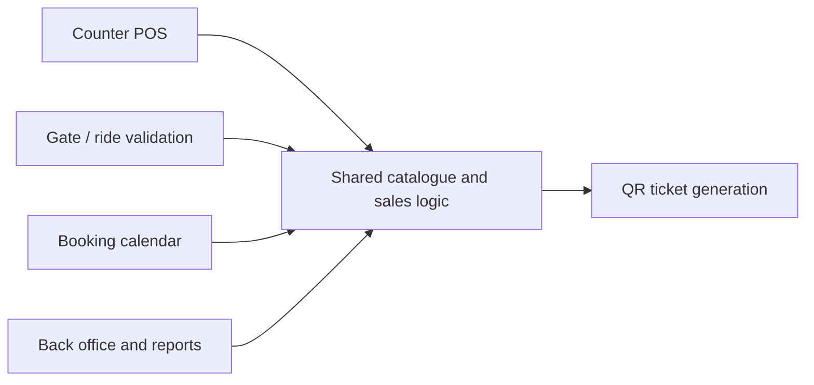

# Liliputer Dunia: Theme Park POS, Ticketing and Back Office (Prototype)

> **Architecture case study.** Source code is private and owned by the client. This repository contains original documentation only: no client code, data, credentials or assets.

## Problem

An indoor theme park needed one system for gate tickets, rides, food counters, advance bookings and back-office reporting, instead of separate tools for each counter.

## Solution

A tender prototype showing an integrated design: a shared catalogue of products and passes, counter POS screens, QR-coded tickets, a booking calendar and a back-office view. It was built to demonstrate the architecture and user flows.

## Architecture

## Modules

- **POS**: counter sales for tickets, rides, food
- **Ticketing**: QR ticket issue and validation
- **Booking**: advance bookings and parties
- **Back office**: products, pricing, daily reports

## Tech stack

- Next.js 15, React 19, TypeScript
- Tailwind CSS
- QR code generation for tickets

## Key design decisions

1. One catalogue for tickets, rides and food so every counter sells from the same price list.
2. QR tickets make entry and ride validation fast and auditable.
3. Prototype first: flows were validated with stakeholders before committing to a production backend.

---

Designed and delivered by [Adil Ahmed](https://github.com/AdilAhmedAhir) at [Start Daily xyz Limited](https://startdaily.xyz), Dhaka.
